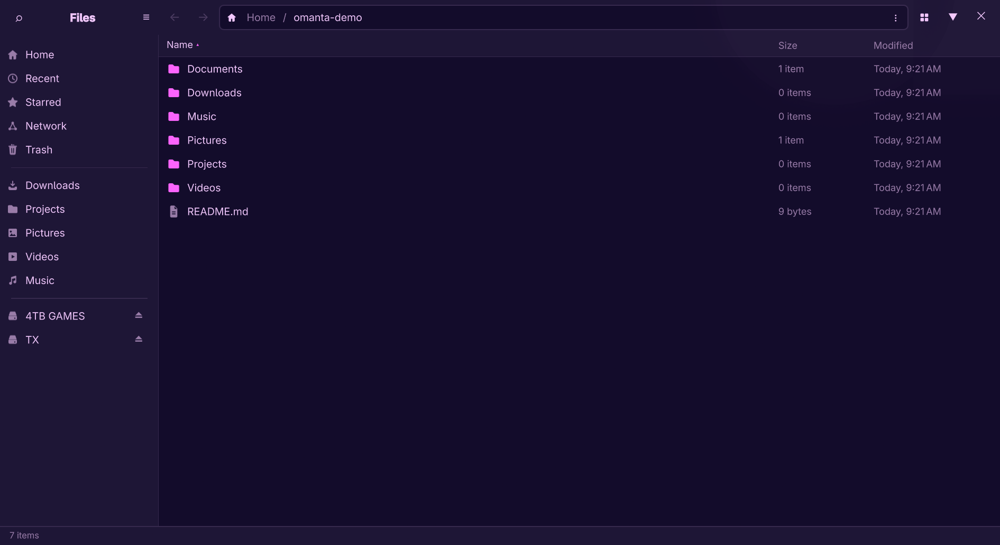

# omanta

A native file manager for [Omarchy](https://omarchy.org), built with Qt Quick
and GIO as a drop-in replacement for GNOME Files (Nautilus) — same
keybindings, same launch semantics, same D-Bus integration, themed by your
Omarchy theme.



> **Testing preview.** omanta installs *alongside* your existing file manager
> and stays out of the way until you choose it. The only thing it adds by
> itself is a switch in the Omarchy Toggle menu. The switch flips between the
> two and restores the stock setup byte-identically. Please file issues for
> anything that doesn't behave exactly as you'd expect.

## What you get

- List and grid views, tabs, split view (F3), tree expansion, breadcrumbs +
  Ctrl+L, type-ahead, configurable columns
- Adjustable icon sizes in both views: Ctrl++ / Ctrl+- to resize, Ctrl+0
  to reset, or use View Options → Icon Size. List and grid each keep their
  own size, shared by every window and remembered after a restart.
- Theme-coloured folders with two-tone panels and special-location symbols;
  small icons simplify their detail for clarity.
- All write operations — copy/cut/paste (system clipboard, interops with
  other file managers), move, rename, batch rename, trash, delete — with
  undo/redo and a progress popover
- Thumbnails (images, video, PDF) via the freedesktop spec, sharing the
  system-wide cache
- Places sidebar: devices with mount/unmount/eject, Network (`smb://`,
  `sftp://`) with credential prompts, Trash, Recent, Starred, bookmarks.
  F9 shows or hides it, and the choice is remembered. In a narrow window
  (tiled side by side on a laptop, say) it tucks itself away; F9 or the
  sidebar button slides it back over the files. Drag a folder onto the
  sidebar and a "New Bookmark" row appears to drop it on (Ctrl+D bookmarks
  the folder you are in, including remote ones)
- Drag and drop between folders, tabs, the sidebar and other applications.
  A label under the drag image says what letting go will do — move within a
  filesystem, copy across one, Ctrl forces a copy, Shift forces a move —
  and it changes as you press the keys
- Hidden files: Ctrl+H or Preferences → Show Hidden Files, remembered
  after a restart
- Quick preview: Space (or right-click → Preview) shows the selected file in
  Sushi, the previewer stock Omarchy ships — zoomable images, text,
  Markdown, PDF, audio, video, and office files when LibreOffice is
  installed. Arrow keys step through the folder; Space or Escape closes it
- Open With: right-click a file to open it in any app registered for its
  type, or "Other Application…" to choose one and set the default
- Move to… and Copy to… in the right-click menu: pick a destination folder
  and the selection goes there, with the same name-clash dialog as paste
- New Folder from the + button beside search, Ctrl+Shift+N, or right-click
- Search: recursive filename plus full-text (via `localsearch`), date and
  type filters
- Compress/extract (zip, tar.xz, 7z, encrypted zip), "Extract to…"
- Omarchy theming end to end — follows your active theme live, not just
  light/dark
- Custom context-menu actions from simple TOML files — no extension API
  needed (Omarchy's transcode/LocalSend/Omarchy-Send menu items ship
  included, plus Dropbox share links if you use Dropbox)
- Multi-window single instance, `org.freedesktop.FileManager1` — "open
  containing folder" from browsers and other apps just works
- Its own file chooser: when omanta is the default, the Open and Save
  dialogs of other apps are omanta too — same sidebar, path bar and views,
  a preview of the selected file, the app's file types to choose from
  (files of other types are dimmed), and a Replace question before saving
  over a file. See [The file chooser](#the-file-chooser)

Completed work from a failed or cancelled copy/move remains undoable when it
has not replaced existing files. These partial batches cannot be redone.
Extraction Undo preserves later additions, edits, and replacement files by
refusing to remove an output that has changed.

## Install

Grab the package from the [latest release](https://github.com/28allday/omanta/releases)
and install it:

```bash
curl -LO https://github.com/28allday/omanta/releases/download/v0.1.27/omanta-0.1.27-1-x86_64.pkg.tar.zst
sudo pacman -U omanta-0.1.27-1-x86_64.pkg.tar.zst
```

(The package is unsigned, so pacman won't install it straight from a URL —
download it first and install the local file.)

Or build it yourself:

```bash
git clone https://github.com/28allday/omanta.git
cd omanta/packaging
makepkg -si
```

On ARM (aarch64 — Arch Linux ARM, Asahi, ARM laptops and VMs) there is no
prebuilt package yet, so build it this way. The code has nothing
architecture-specific, and `makepkg` needs only `base-devel` plus the
build tools it installs for you.

Installing changes none of your defaults — Nautilus (or whatever you use)
remains the file manager until you switch.

## Switching

The first time you open omanta, it adds an **Omanta File Manager** row to
the Omarchy Toggle menu (`SUPER+CTRL+O`). Select it to switch either way.
It shows a ✓ while omanta is the default, so the menu doubles as a status
check. If you remove the row, omanta won't add it back.

omanta's **Preferences → Default File Manager** has the same controls:
one switch makes omanta the default, the other shows or hides the
Toggle-menu row.

From a terminal:

```bash
omanta-switch omanta     # make omanta the default
omanta-switch nautilus   # back to stock
omanta-switch toggle     # flip
omanta-switch status     # what's active right now
```

`omanta-switch install-menu` and `omanta-switch remove-menu` add and remove
the Toggle-menu row. The row appears or disappears straight away, with no
shell restart.

Switching makes omanta (or Nautilus) the default everywhere at once:
`SUPER+SHIFT+F`, folders opened from other apps, and double-clicked
archives. It works by flipping the xdg-mime defaults and writing a
managed, clearly-marked block to `~/.config/hypr/bindings.lua` —
Omarchy's own files are never modified, no logout needed, and switching
back restores your configuration byte-for-byte. It also drops a user-level
D-Bus `.service` file for `org.freedesktop.FileManager1`, so "show in
folder" from a browser starts omanta (with `--service`, no extra window)
instead of activating Nautilus when neither is running. One note:
whichever file manager has windows open keeps that name until its last
window closes, so close the other one's windows after switching; omanta
takes the name over on its own once Nautilus exits.

## The file chooser

When omanta is the default (see above), the Open, Save and Select Folder
dialogs that other apps show are omanta's own. Apps ask the desktop for a
file through `xdg-desktop-portal`; switching to omanta names omanta as the
portal's file chooser, and switching back hands it to the GTK one again.
If you switched to omanta before version 0.1.27, run `omanta-switch omanta`
once more to turn the file chooser on.

- **Open**: pick a file (or several, when the app allows it) and press
  Enter, double-click it, or use the Open button. The panel on the right
  previews the selection; the panel button at the top right hides it. The **Show** menu at the
  bottom lists the file types the app accepts; files of other types stay
  visible but dimmed, and cannot be picked.
- **Save**: the name box at the top is ready to type in, with the name
  (not the extension) selected. Click a file to reuse its name. Saving
  over an existing file asks first. The + button makes a new folder.
- **Select Folder**: only folders are listed. Enter or double-click walks
  into a folder; the button (or Ctrl+Enter) chooses the selected folder,
  or the one you are in when nothing is selected.
- Anywhere: Ctrl+L or typing `/` or `~` starts typing a path, Ctrl+F
  searches, Ctrl+H shows hidden files, Alt+←/→/↑ go back, forward and up,
  Escape cancels.

Which apps use it: everything that asks the desktop portal for its
dialogs, such as Chromium-based browsers, GTK 4 apps and Flatpaks. An app
that draws its own GTK dialog without asking the portal keeps showing the
GTK one.

How it is wired, for the curious: the package installs
`/usr/share/xdg-desktop-portal/portals/omanta.portal` and a D-Bus service
that starts `omanta --portal` on demand (it lingers a few minutes after the
last dialog, then exits). `omanta-switch omanta` adds
`org.freedesktop.impl.portal.FileChooser=omanta` to
`~/.config/xdg-desktop-portal/hyprland-portals.conf` — creating that file
as a copy of the system one if you have none — restarts
`xdg-desktop-portal` so it takes effect, and adds a Hyprland rule that
floats the picker window, fully opaque so the app behind it never shows
through. `omanta-switch nautilus` removes the line (or the whole file, if
omanta created it). `omanta-switch status` shows which file chooser is
active.

## Uninstall

```bash
omanta-switch nautilus && omanta-switch remove-menu   # stock default, no menu row
sudo pacman -R omanta
```

## Requirements

Arch with Omarchy. Dependencies (`qt6-base`, `qt6-declarative`, `glib2`,
`gvfs`, `libarchive`, `tinysparql`) are all in Omarchy's default install or
pulled automatically. Optional: `gvfs-smb`/`gvfs-mtp`/`gvfs-gphoto2` for
network shares, phones and cameras, `ffmpegthumbnailer` for video
thumbnails, `localsearch` for full-text search.

## Hacking on it

These scripts work from any directory:

```bash
./bin/build      # cmake + ninja into build/, then run ./build/omanta
./bin/test       # the headless suites (ctest, ~25s)
./bin/test-sanitizers # Clang ASan, UBSan and leak checks
./bin/install    # user-local install: ~/.local/bin symlink, desktop entry, icon
```

`./bin/install` never touches `/usr` or pacman, and installs alongside your
existing file manager — later rebuilds are picked up without reinstalling. For
a real package instead, use the `makepkg -si` route above.

Requires `cmake`, `ninja` and the Qt 6 development packages in addition to the
runtime dependencies above.

The Empty Trash integration test also needs `bubblewrap` and GVfs. It runs
with a separate filesystem, home directory and D-Bus session; it is skipped
when those dependencies are unavailable. The full-disk and permission tests
also require `bubblewrap`. See the [validation report](docs/validation-v0.1.13.md)
for the latest integration checks and their limits.

## License

MIT
